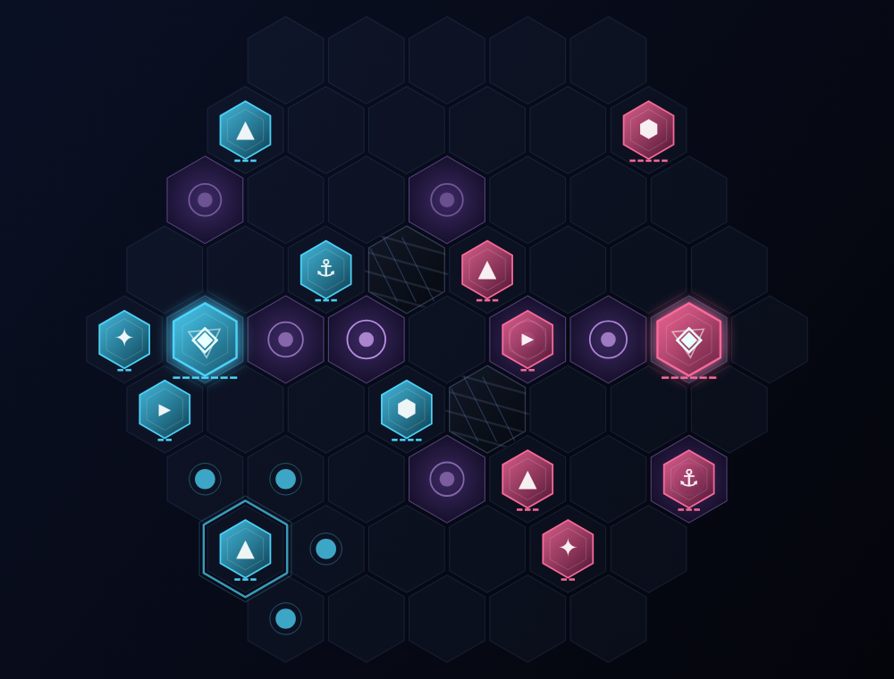

# РЕЗОНАНС — дуэль ткачей

> Оригинальная пошаговая дуэль на гексагональной арене. Два Ткача, один контур, два действия за ход.
> Офлайн против семи ботов, кампания, испытания — и полноценный онлайн с лобби, рейтингом и топом игроков.



## Скачать (Windows, .exe)

**[⬇ Rezonans.exe](https://github.com/ritmiro1/Game/raw/arena/e84233e1-game/download/Rezonans.exe)** (~300 КБ, портативный, без установки)

Как это работает: файл запускает встроенный локальный сервер и открывает игру в отдельном
безрамочном окне (Edge/Chrome в режиме приложения). Ничего не устанавливается, реестр не трогается.

> Windows SmartScreen может ругаться на неподписанный файл: «Подробнее» → «Выполнить в любом случае».
> Если Edge/Chrome не найден — игра откроется в браузере по умолчанию.

## Что это за игра

Никаких шахмат, шашек и карт. «Резонанс» — дуэль **энергии и темпа** на гексагональной арене.
Каждый ход у Ткача **два действия**: подвинуть юнита, ударить, применить способность или призвать
подкрепление. Атаки и способности стоят энергии, а энергию дают захваченные узлы (◎) и резонаторы.
Побеждает тот, кто уничтожит вражеское **Ядро** или удержит больше контроля к 40-му ходу.

### Юниты
| Юнит | Роль |
|---|---|
| **Ядро** ◈ | Сердце контура. Неподвижно, но отбрасывает врагов «Импульсом». Урон по Ядру удвоен. |
| **Клинок** ▲ | Главный урон. 2 урона за 2 энергии. Рассечение бьёт всех соседей. |
| **Страж** ⬢ | Не умеет ранить. Ставит барьеры — коридоры, которые нельзя пройти. |
| **Гонец** ▸ | Прыгает через излом на две клетки. Ставит Метку: цель получает +1 к любому урону. |
| **Крюк** ⚓ | Гарпун вытаскивает врага из строя и подставляет под удар. |
| **Резонатор** ✦ | Экономика: +1 энергии в ход и лечение контура вокруг себя. |

### Фракции
* **Дом Кантус** — старт с запасом энергии, усиленные резонаторы, крепкое Ядро.
* **Хор** — длинный гарпун, крепкие стражи, энергия за убийства.
* **Ноль** — злые клинки и гонцы, прыгающие на три клетки. Стеклянная пушка.

### Правила, которые надо знать
* 2 действия за ход, переход хода — автоматически или кнопкой «Завершить ход» (Space).
* Атака Клинка — 2 энергии, Гарпуна — 1. Движение бесплатно.
* Узлы (◎) дают +1 энергии каждый ход. Захват узлов = экономика = темп.
* С 24-го хода начинается **Разлом**: весь урон +1. Стоять нельзя.
* Призыв Гонца — 4 энергии, не больше 8 юнитов одновременно.

## Что внутри

**Режимы**
* **Быстрая дуэль** — 7 ботов, 7 уровней сложности, 3 фракции, 10 арен.
* **Кампания** — 8 глав с историей станции «Тихий Резонатор».
* **Испытания** — 6 задач на точный расчёт («убей Ядро за N действий»).
* **Дуэль на одном экране** — хотсит для двоих.
* **Онлайн** — лобби, создание/вход в дуэль, быстрый подбор, рейтинг Эло, топ игроков, общий чат.

**ИИ** — негамакс с альфа-бета отсечением, таблица транспозиций, итеративное углубление,
упорядочивание ходов, «спокойный поиск» по взятиям и 7 уровней силы (от ученика до Тишины,
которая думает до 2.6 секунды на ход). Считается в отдельном Web Worker, интерфейс не подвисает.

**Технически**
* Детерминированный движок правил — один и тот же код проверяет ходы в браузере и на сервере.
* Анимации на canvas: полёт фишек, лучи атак, ударные волны, частицы, тряска экрана.
* Процедурный звук (WebAudio) — без единого аудиофайла.
* Сервер авторитетен: клиент присылает действие, сервер проверяет его движком и рассылает состояние.

## Запуск из исходников

```bash
npm install
npm start            # http://localhost:8080  (статика + WebSocket на одном порту)
```

Открой `http://localhost:8080/` в двух вкладках — одна создаёт дуэль, вторая входит.
Для игры по сети между машинами достаточно открыть порт 8080: сервер слушает `0.0.0.0`.

## Сборка

```bash
npm run build        # dist/rezonans.html — вся игра в одном файле (205 КБ)
npm run build:exe    # dist + native/game_html.h + download/Rezonans.exe (нужен zig)
```

`.exe` собирается кросс-компиляцией `zig cc -target x86_64-windows-gnu` из `native/launcher.c`:
лаунчер поднимает HTTP-сервер на 127.0.0.1 со встроенной игрой и открывает её в оконном режиме
браузера. Поэтому в одном файле лежит вся игра целиком.

## Тесты

```bash
npm test                     # движок: легальность, завершаемость, кодирование состояния
node tools/net-test.js       # сетевой протокол: лобби, дуэль, Эло, чат, подбор
node tools/play-test.js      # автопрогон партий через UI (jsdom)
node tools/shot.js           # рендер арены в PNG
```

## Структура

```
shared/   content.js (юниты, фракции, арены, кампания) · engine.js (правила) · ai.js (поиск)
web/      index.html · css/style.css · js/{app,game,render,net,ui,audio,worker}.js
server/   server.js — статика + WebSocket: лобби, дуэли, Эло, топ, чат
native/   launcher.c — Windows-лаунчер (встроенный HTTP + запуск окна игры)
tools/    build.js, build-exe.js, тесты
```

Лицензия MIT.
